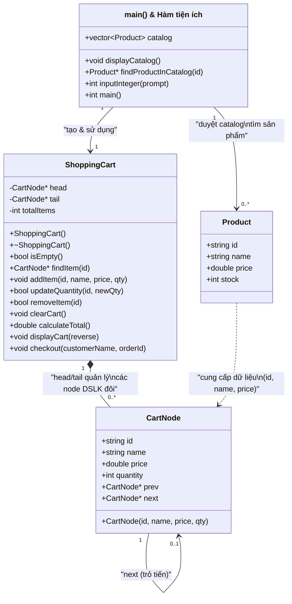
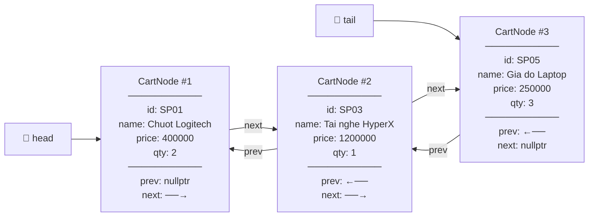
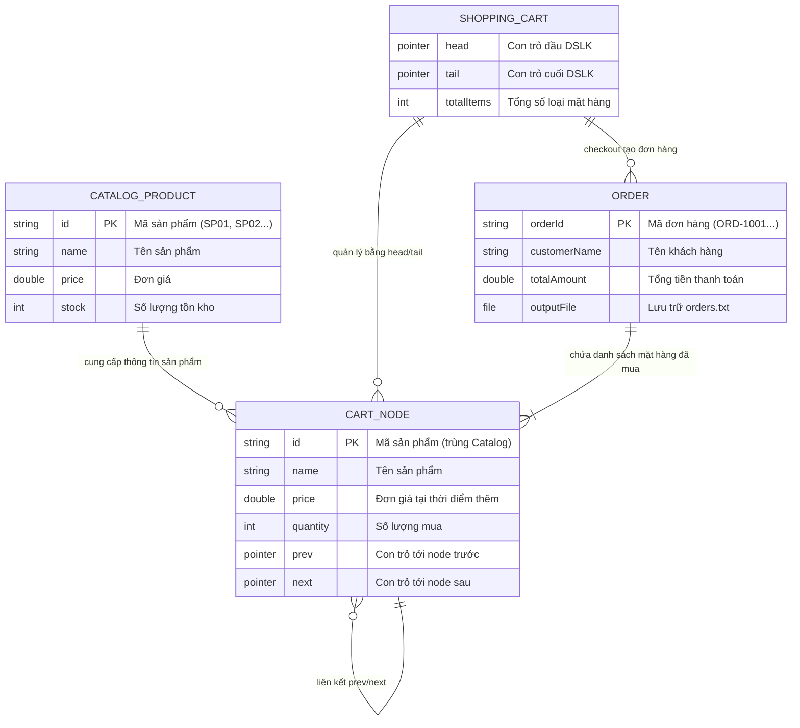
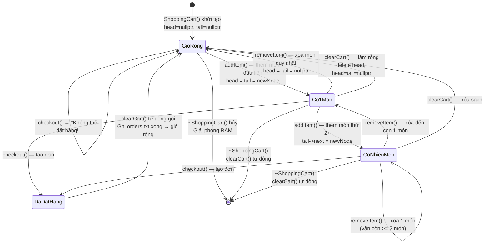

# SƠ ĐỒ MỐI QUAN HỆ — DỰ ÁN QUẢN LÝ GIỎ HÀNG ONLINE
**Nguồn:** [main.cpp](file:///C:/Users/My%20PC/.gemini/antigravity/scratch/QuanLyGioHang/main.cpp)

---

## 1. SƠ ĐỒ LỚP (CLASS DIAGRAM)
> Thể hiện các thực thể dữ liệu và mối quan hệ giữa chúng: **Product** (kho hàng), **CartNode** (node trong DSLK đôi), **ShoppingCart** (lớp quản lý giỏ).



---

## 2. SƠ ĐỒ CẤU TRÚC BỘ NHỚ DANH SÁCH LIÊN KẾT ĐÔI
> Minh họa trực quan cách các con trỏ `head`, `tail`, `prev`, `next` liên kết các **CartNode** trên vùng nhớ Heap khi giỏ hàng có 3 sản phẩm.



---

## 3. SƠ ĐỒ MỐI QUAN HỆ THỰC THỂ (ER DIAGRAM)
> Mô hình hóa các thực thể dữ liệu và quan hệ nghiệp vụ giữa **Danh mục kho hàng**, **Giỏ hàng**, **Mặt hàng trong giỏ** và **Đơn hàng**.



---

## 4. SƠ ĐỒ LUỒNG HOẠT ĐỘNG TỔNG THỂ (ACTIVITY FLOW)
> Mô tả luồng tương tác chính từ Menu → Kho hàng → Giỏ hàng → Đơn hàng → File lưu trữ.

```mermaid
flowchart TD
    START(["🟢 Bắt đầu chương trình"]) --> MENU["Hiển thị MENU CHỨC NĂNG\n(9 lựa chọn: 0-8)"]
    
    MENU -->|"1"| CAT["📋 displayCatalog()\nHiển thị kho hàng mẫu\nvector<Product> catalog"]
    MENU -->|"2"| ADD_FLOW

    subgraph ADD_FLOW["Luồng THÊM MẶT HÀNG VÀO GIỎ"]
        A1["Hiển thị Catalog"] --> A2{"findProductInCatalog(id)\nSP có trong kho?"}
        A2 -->|"Không tìm thấy"| A_ERR["Báo lỗi: Mã SP\nkhông tồn tại"]
        A2 -->|"Tìm thấy"| A3["Nhập số lượng qty"]
        A3 --> A4{"Kiểm tra hợp lệ?\nqty > 0 && qty <= stock"}
        A4 -->|"Không hợp lệ"| A_ERR2["Báo lỗi nhập liệu"]
        A4 -->|"Hợp lệ"| A5{"findItem(id)\nĐã có trong giỏ?"}
        A5 -->|"Đã có"| A6["Cộng dồn:\nexisting->quantity += qty"]
        A5 -->|"Chưa có"| A7["Tạo CartNode mới\nnew CartNode(...)"]
        A7 --> A8{"Giỏ đang rỗng?\nhead == nullptr"}
        A8 -->|"Rỗng"| A9["head = tail = newNode"]
        A8 -->|"Có phần tử"| A10["tail->next = newNode\nnewNode->prev = tail\ntail = newNode"]
    end

    MENU -->|"3, 4"| DISPLAY["👁️ displayCart(reverse)\nDuyệt xuôi/ngược DSLK đôi"]
    MENU -->|"5"| UPDATE["✏️ updateQuantity(id, newQty)\nTìm node → cập nhật quantity"]
    MENU -->|"6"| REMOVE

    subgraph REMOVE["Luồng XÓA MẶT HÀNG"]
        R1{"findItem(id)\nTìm thấy node?"}
        R1 -->|"Không"| R_ERR["Báo lỗi"]
        R1 -->|"Tìm thấy curr"| R2{"Vị trí của curr?"}
        R2 -->|"Node duy nhất\nhead == tail"| R3["head = tail = nullptr"]
        R2 -->|"Đầu danh sách\ncurr == head"| R4["head = head->next\nhead->prev = nullptr"]
        R2 -->|"Cuối danh sách\ncurr == tail"| R5["tail = tail->prev\ntail->next = nullptr"]
        R2 -->|"Ở giữa"| R6["curr->prev->next = curr->next\ncurr->next->prev = curr->prev"]
        R3 --> R7["delete curr\ntotalItems--"]
        R4 --> R7
        R5 --> R7
        R6 --> R7
    end

    MENU -->|"7"| CLEAR["🗑️ clearCart()\nVòng lặp delete từng node\nhead = tail = nullptr"]
    MENU -->|"8"| CHECKOUT

    subgraph CHECKOUT["Luồng TẠO ĐƠN HÀNG"]
        C1{"isEmpty()?\nGiỏ có hàng?"}
        C1 -->|"Rỗng"| C_ERR["Báo lỗi: Không thể đặt"]
        C1 -->|"Có hàng"| C2["calculateTotal()\nTính tổng tiền"]
        C2 --> C3["In hóa đơn ra Console"]
        C3 --> C4["Ghi file orders.txt\nofstream append"]
        C4 --> C5["clearCart()\nLàm rỗng giỏ hàng"]
    end

    MENU -->|"0"| EXIT(["🔴 Kết thúc\n~ShoppingCart() giải phóng RAM"])

    CAT --> MENU
    ADD_FLOW --> MENU
    DISPLAY --> MENU
    UPDATE --> MENU
    REMOVE --> MENU
    CLEAR --> MENU
    CHECKOUT --> MENU
```



---

## 5. SƠ ĐỒ TƯƠNG TÁC GIỮA CÁC THÀNH PHẦN (SEQUENCE DIAGRAM)
> Trình tự giao tiếp khi người dùng thực hiện thao tác **Thêm sản phẩm vào giỏ** và **Checkout** — 2 luồng chính nhất của chương trình.

```mermaid
sequenceDiagram
    actor User as 👤 Người dùng
    participant Main as main()
    participant Cat as catalog<br/>(vector&lt;Product&gt;)
    participant Cart as ShoppingCart
    participant Node as CartNode<br/>(Heap Memory)
    participant File as orders.txt

    Note over User, File: 📌 LUỒNG 1: THÊM SẢN PHẨM VÀO GIỎ HÀNG

    User ->> Main: Chọn Menu 2
    Main ->> Cat: displayCatalog()
    Cat -->> User: Hiển thị danh mục kho hàng
    User ->> Main: Nhập mã SP (VD: SP01)
    Main ->> Cat: findProductInCatalog("SP01")
    Cat -->> Main: Trả về con trỏ Product*
    User ->> Main: Nhập số lượng (VD: 2)
    Main ->> Cart: addItem("SP01", "Chuot...", 400000, 2)
    Cart ->> Cart: findItem("SP01") — Duyệt DSLK
    
    alt Sản phẩm chưa có trong giỏ
        Cart ->> Node: new CartNode("SP01", ...)
        Node -->> Cart: Trả về con trỏ newNode
        Cart ->> Cart: tail->next = newNode<br/>newNode->prev = tail<br/>tail = newNode
        Cart -->> User: ✅ Đã thêm thành công!
    else Sản phẩm đã có trong giỏ
        Cart ->> Node: existing->quantity += 2
        Cart -->> User: ✅ Đã cộng dồn số lượng!
    end

    Note over User, File: 📌 LUỒNG 2: CHECKOUT TẠO ĐƠN HÀNG

    User ->> Main: Chọn Menu 8
    Main ->> Cart: displayCart(false)
    Cart -->> User: Hiển thị bảng giỏ hàng
    User ->> Main: Nhập tên khách hàng
    Main ->> Cart: checkout("Nguyen Van A", "ORD-1001")
    Cart ->> Cart: calculateTotal() — Duyệt tính tổng
    Cart -->> User: In hóa đơn ra Console
    Cart ->> File: ofstream ghi chi tiết đơn hàng
    File -->> Cart: Ghi thành công ✅
    Cart ->> Cart: clearCart() — Giải phóng toàn bộ node
    Cart ->> Node: delete từng CartNode trên Heap
    Cart -->> User: ✅ Đơn hàng đã tạo, giỏ đã rỗng!
```

---

## 6. SƠ ĐỒ TRẠNG THÁI GIỎ HÀNG (STATE DIAGRAM)
> Các trạng thái mà đối tượng **ShoppingCart** có thể ở trong suốt vòng đời chương trình, và sự kiện nào gây chuyển đổi trạng thái.


